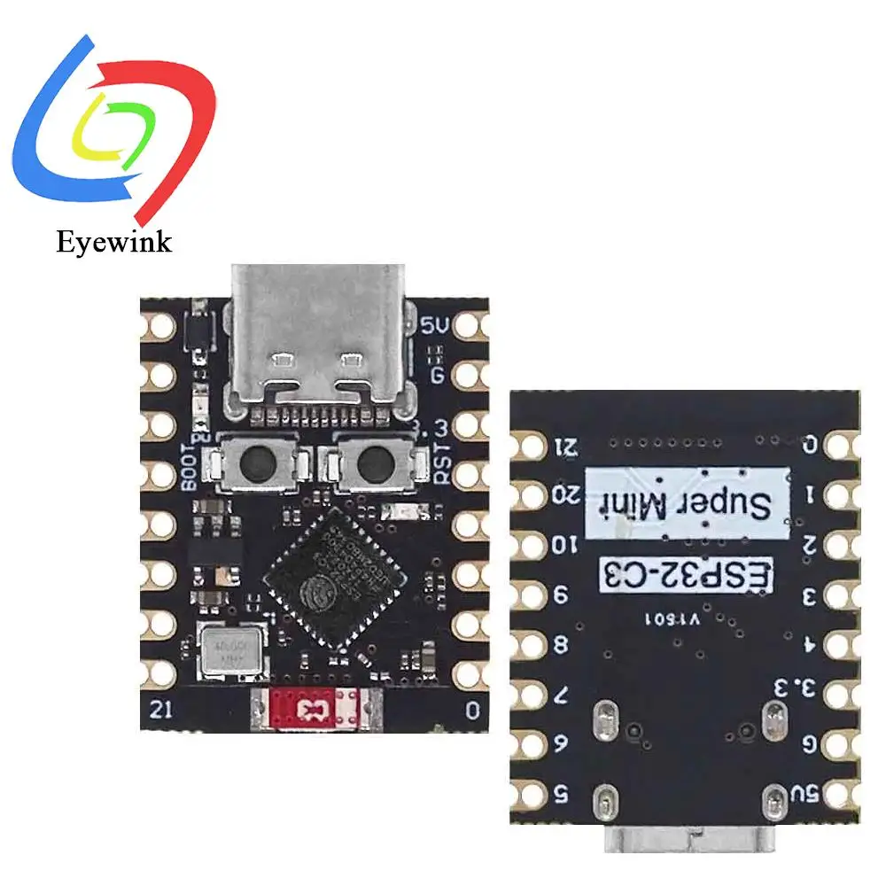
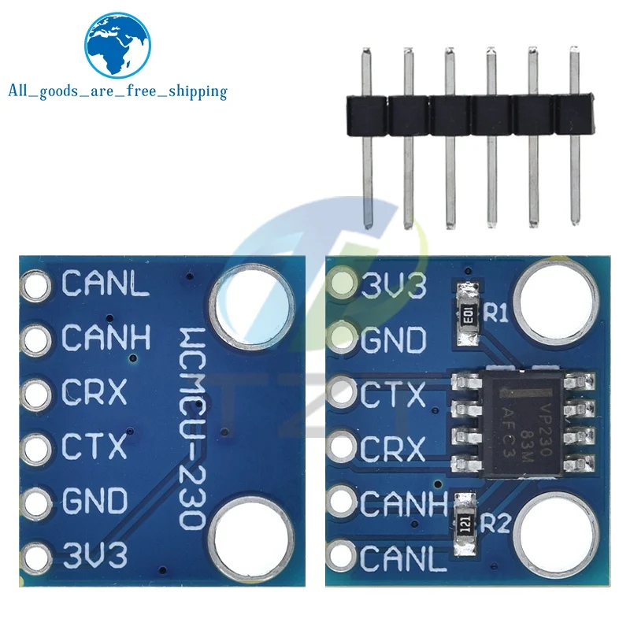
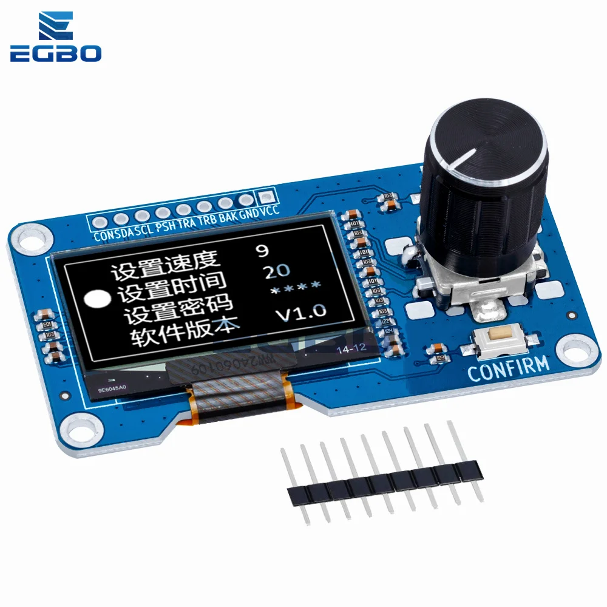
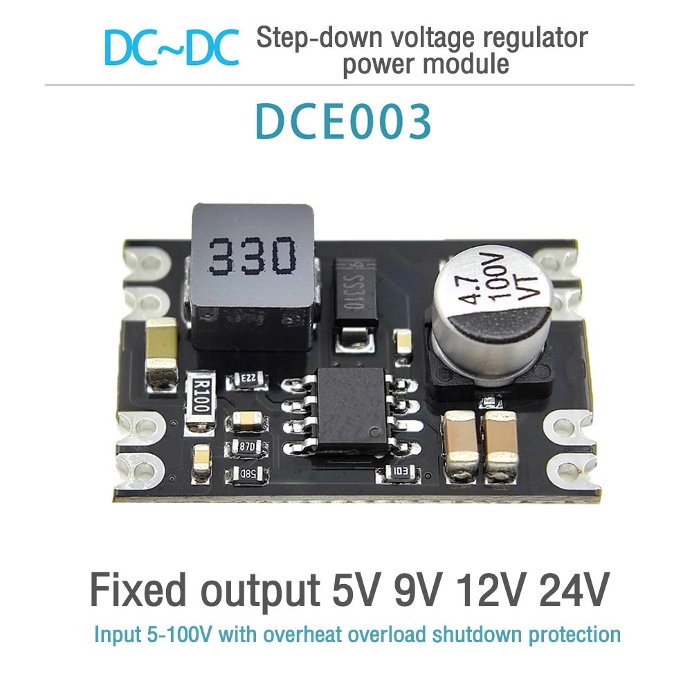

# Eltek Flatpack2 HE 2000W — Adjustable Power Supply / Battery Charger

A project to convert an **Eltek Flatpack2 HE 2000W** (48V) server rectifier into a compact adjustable benchtop power supply and battery charger with CAN-bus control based on the **ESP32-C3 SuperMini**.

> ⚠️ **Warning / Safety:** This device operates with hazardous AC mains voltage (~230V AC) and high DC output currents (up to ~37.4A DC). Perform all wiring and assembly with power disconnected and follow proper electrical safety precautions.

---

## 📸 Photos & Assembly Process

> _Work in progress — photos of the finished build and step-by-step assembly will be added later._

<!--
Example after adding photos to images/:

-->

---

## ✨ Features

- Output voltage adjustment in the **44.5 – 57.6 V** range (safe default: **48.0 V**).
- Output current limiting in the **0.1 – 37.4 A** range (safe default: **5.0 A**).
- Selectable adjustment step: **0.1** or **1.0** (V / A).
- Setpoint confirmation: unconfirmed changes blink for 5 seconds and automatically revert if not confirmed.
- Persistent settings stored in ESP32 non-volatile memory (`Preferences` / NVS).
- Quick reset to safe defaults (`48.0 V / 5.0 A`) by holding the `BAK` button.
- Live telemetry on the OLED display: **CV / CC** mode, AC input voltage (`IN`), actual output voltage and current, and CAN link status (`NO LINK` when disconnected).
- Detailed CAN-bus diagnostics over Serial Monitor (`115200` baud).

---

## 📁 Project Structure

- [`3d_models/`](./3d_models/) — STL files for 3D printing the enclosure and controls:
  - [`FP2_Case.stl`](./3d_models/FP2_Case.stl) — enclosure / front panel
  - [`FP2_Button.stl`](./3d_models/FP2_Button.stl) — button / cap
- [`Esp32C3_SuperMini_Can_Display_FP2_Controller/`](./Esp32C3_SuperMini_Can_Display_FP2_Controller/) — **Arduino IDE** firmware:
  - [`Esp32C3_SuperMini_Can_Display_FP2_Controller.ino`](./Esp32C3_SuperMini_Can_Display_FP2_Controller/Esp32C3_SuperMini_Can_Display_FP2_Controller.ino)
- _**PlatformIO** firmware — to be added later._

---

## 🧰 Bill of Materials (BOM)

> _Additional consumables (wires, power terminals, AC cord, fasteners, etc.) will be added later._

Main components:
- **Eltek Flatpack2 HE 2000W** (48V) power supply
- **ESP32-C3 SuperMini** microcontroller
- **SN65HVD230 (VP230) CAN Bus Transceiver** module *(see warning below regarding counterfeit ICs)*
- **1.3" SH1106 128x64 I2C OLED Display + EC11 Rotary Encoder & Buttons** combined module (`EGBO`)
- **DC-DC Buck Converter (5–100V → 5V)** for powering the controller logic from the Flatpack2 output
- Input/output terminals, power cord, fasteners (_to be specified_)

---

## 🛒 Module Links (AliExpress)

| Module | Photo | Link & Notes |
| :--- | :---: | :--- |
| **ESP32-C3 SuperMini** |  | [AliExpress](https://www.aliexpress.com/item/1005009014269977.html) |
| **SN65HVD230 CAN Bus Transceiver** |  | [AliExpress](https://www.aliexpress.com/item/1005008770382370.html) ⚠️ **Important:** This listing ships with a **counterfeit `VP230` IC** that may not work reliably. You will need to replace the chip with an original **TI SN65HVD230 (`VP230`)** or order a module with a genuine IC from another seller. |
| **1.3" OLED Display + EC11 Rotary Encoder Module** |  | [AliExpress](https://www.aliexpress.com/item/1005007584860095.html) Select the **1.3" White OLED (SH1106)** variant. |
| **DC-DC Buck Converter (5–100V to 5V)** |  | [AliExpress](https://www.aliexpress.com/item/1005008604140432.html) Select the **5V** output version to power the ESP32-C3 from the 44.5–57.6V output bus. |

---

## 🔌 Wiring / Pinout (ESP32-C3 SuperMini)

| Signal | ESP32-C3 Pin | Notes |
| :--- | :--- | :--- |
| `CAN_TX` | `GPIO 7` | To CAN transceiver TX (125 kbps) |
| `CAN_RX` | `GPIO 10` | To CAN transceiver RX |
| `I2C_SDA` | `GPIO 5` | SH1106 OLED display |
| `I2C_SCL` | `GPIO 6` | SH1106 OLED display |
| `ENC_A` (TRA) | `GPIO 0` | Encoder channel A (`INPUT_PULLUP`) |
| `ENC_B` (TRB) | `GPIO 1` | Encoder channel B (`INPUT_PULLUP`) |
| `BTN_BAK` | `GPIO 2` | ⚠️ Strapping pin — do not hold pressed during boot |
| `BTN_PSH` | `GPIO 3` | Confirm / toggle `V ↔ A` |
| `BTN_CON` | `GPIO 4` | Toggle step `0.1 ↔ 1.0` |

---

## 🎛️ Controls

- **Rotate encoder** — adjust the active setpoint (voltage or current). The modified value starts blinking.
- **`PSH` button**:
  - If a value is blinking (awaiting confirmation) — **confirms** the change and saves it to NVS.
  - Otherwise — toggles editing between **Voltage (`V`)** and **Current (`A`)**.
- **`CON` button** — toggles the adjustment step: **`0.1`** ↔ **`1.0`**.
- **`BAK` button** (hold ~600 ms) — loads the safe preset **`48.0 V / 5.0 A`** (requires `PSH` confirmation).

---

## 🖨️ 3D Printing

Printable files are located in [`3d_models/`](./3d_models/):
- [`FP2_Case.stl`](./3d_models/FP2_Case.stl)
- [`FP2_Button.stl`](./3d_models/FP2_Button.stl)

> _Recommended filament (PETG/ABS/ASA), infill, and print orientation notes will be added later._

---

## 💻 Firmware

### Arduino IDE
1. Open [`Esp32C3_SuperMini_Can_Display_FP2_Controller.ino`](./Esp32C3_SuperMini_Can_Display_FP2_Controller/Esp32C3_SuperMini_Can_Display_FP2_Controller.ino) in Arduino IDE.
2. Install **ESP32** board support and the **U8g2** library.
3. Select **ESP32C3 Dev Module** (or equivalent for SuperMini; enable `USB CDC On Boot` if needed for Serial Monitor output).
4. Upload the sketch to the board.

### PlatformIO
> _PlatformIO project configuration and build instructions will be added later._
